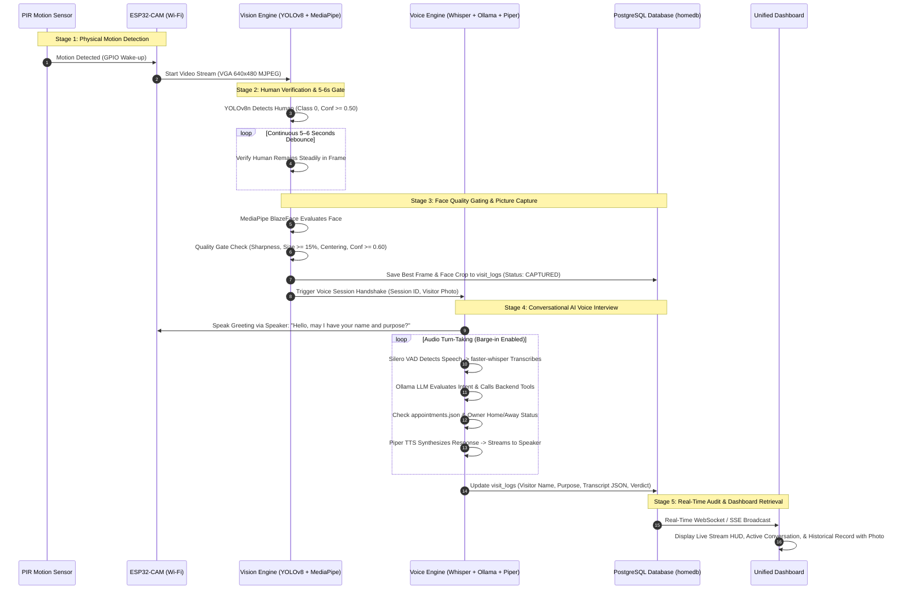

# Autonomous AI Smart Home Security & Doorbell System
## Master Architecture, Current Status & End-to-End Integration Plan

---

## 1. Executive Project Overview

The **Autonomous AI Smart Home Security & Doorbell System** is an intelligent, edge-computing security gateway that autonomously senses approaching visitors, verifies their presence, captures high-quality facial biometric photographs, conducts real-time natural language voice interviews, validates access rights against homeowner appointments and security rules, and persists rich audit records for homeowner review.

### Core Philosophy
1. **100% Local Intelligence & Privacy**: Zero reliance on external cloud APIs. All computer vision (YOLOv8n, MediaPipe BlazeFace), Speech-to-Text (faster-whisper on CUDA), Natural Language Understanding (Local Ollama LLM), and Speech Synthesis (Piper TTS) run completely locally on the host security server.
2. **Edge Hardware Sensing**: Low-power microcontrollers (ESP32-CAM and ESP32 with INMP441 MEMS microphone) manage physical sensing, streaming audio and video across Wi-Fi and high-speed serial.
3. **Multi-Stage Physical Gating**: Prevents false alarms, phantom doorbells, and blurred captures by strictly chaining PIR motion detection $\rightarrow$ continuous 5–6 second human presence verification $\rightarrow$ MediaPipe geometric face quality gating.
4. **Deterministic Security Enforcement**: The LLM is restricted to security interview dialogue and structured tool-calling. Final access authorization (`APPROVED`, `DENIED`, `MESSAGE_TAKEN`) is determined deterministically by backend security managers and rules, not by ungrounded model hallucinations.

---

## 2. End-to-End System Operation & Flow

The unified system executes according to the following end-to-end operational sequence:



### Detailed Operational Stages

#### Stage 1: Motion Wake-Up (PIR Sensor)
* The PIR motion sensor (HC-SR501 or AM312) monitors the doorway perimeter.
* When a warm body moves into range, the PIR output goes `HIGH`, triggering a hardware interrupt on the ESP32.
* The ESP32 wakes up the camera subsystem and starts broadcasting the video stream to the central server.

#### Stage 2: Human Verification & 5–6 Second Presence Gate
* Once video ingestion begins, the **YOLOv8n Human Detector** analyzes each frame.
* A single fleeting detection does **not** ring the doorbell or trigger the AI.
* **The 5–6 Second Presence Gate**: The system initiates an internal high-resolution timer. The visitor must remain continuously in frame for at least 5 to 6 seconds. If the person walks past the door without stopping or leaves before 5 seconds, the countdown resets to zero, preventing false triggers from pets, shadows, or passing neighbors.

#### Stage 3: Face Detection & Quality-Gated Capture
* Once the 5–6 second human threshold is satisfied, the system shifts into **`WAITING_FOR_FACE`** mode.
* The **MediaPipe BlazeFace** short-range face detector activates alongside YOLO.
* The frame quality engine evaluates the face candidate across four mathematical dimensions:
  1. **Bounding Box Size Ratio**: Face width and height must each be $\ge 15\%$ of frame dimensions (ensures the visitor is within 1.0–1.5m conversational distance).
  2. **Centering Tolerance**: Face center offset must fall within $25\%$ of frame center.
  3. **Sharpness Score**: Laplacian variance $\ge 80.0$ (rejects motion-blurred frames).
  4. **Confidence**: Detection score $\ge 0.60$.
* The system buffers candidates across a 5-frame stability window and selects the highest composite quality score:
  $$Q = 0.30 \cdot \text{Conf} + 0.30 \cdot \text{Size} + 0.20 \cdot \text{Center} + 0.20 \cdot \text{Sharpness}$$
* The winning full-frame JPEG and cropped face thumbnail are persisted to disk and committed to the database table `visit_logs`.

#### Stage 4: Autonomous Conversational AI Doorbell Interview
* With the visitor verified and photographed, the system immediately starts a voice session.
* **Greeting**: Piper TTS generates a polite greeting through the speaker: *"Hello! Welcome. May I please have your name and the purpose of your visit?"*
* **Listening & VAD**: The visitor speaks into the ESP32 INMP441 microphone. Silero VAD segments voice activity from ambient street noise.
* **GPU Speech-to-Text**: `faster-whisper` (`small`, `float16` on CUDA) transcribes speech into text in under 180ms, tuned for Indian English accents.
* **Structured Security Dialogue**:
  - The local Ollama LLM processes the visitor's answer.
  - The LLM extracts the visitor's name and stated purpose.
  - The LLM uses backend tool calls (`get_appointments`, `get_owner_status`) to query `server/data/appointments.json`.
  - If an appointment is confirmed, access is marked **`APPROVED`**.
  - If no appointment exists and the owner is away, the system enters **`TAKE_MESSAGE`** mode, recording the visitor's message before concluding with **`MESSAGE_TAKEN`**.
  - If the visitor acts suspiciously or refuses to identify themselves, the state machine transitions to **`DENIED`**.

#### Stage 5: Database Commit & Real-Time Dashboard Display
* All metadata—timestamp, duration, photo paths, extracted name, extracted purpose, final access decision, and full verbatim conversation transcript—is committed to PostgreSQL.
* The frontend dashboard automatically updates:
  - Live HUD displaying camera feed and bounding boxes.
  - Live visitor profile card showing their captured photo, identified name, and verified appointment.
  - Real-time conversation chat feed displaying both visitor transcripts and AI speech.
  - Searchable historical visitor table with high-resolution image inspection modals.

---

## 3. Current Implementation Status (Completed Modules)

The core functional layers of the project have already been designed, implemented, and verified in the codebase:

| Subsystem | Component | Implementation File | Status | Technical Details |
|---|---|---|---|---|
| **Audio** | Voice Activity Detection | `server/audio/vad.py` | **Completed** | Silero VAD v4, 512-sample chunk streaming, stateful SILENCE $\leftrightarrow$ SPEECH state machine. |
| **Audio** | Speech-to-Text (STT) | `server/audio/stt.py` | **Completed** | `faster-whisper` (`small`, `float16` CUDA), prompt-guided transcription for Indian English. |
| **Audio** | Text-to-Speech (TTS) | `server/audio/tts.py` | **Completed** | `Piper TTS` (`en_US-amy-medium`), low-latency ONNX runtime, streaming sentence pipelining. |
| **Audio** | ESP32 Mic Receiver | `server/audio/esp32_receiver.py` | **Completed** | PySerial reader for INMP441 I2S microphone (16kHz 16-bit mono PCM), DTR/RTS bootloader trap fix. |
| **Dialogue** | Conversation State Machine | `server/conversation/manager.py` | **Completed** | 11-state deterministic transitions (`GREETING` $\rightarrow$ `ASK_NAME` $\rightarrow$ `ASK_PURPOSE` $\rightarrow$ `CHECK_APPT`). |
| **Dialogue** | Security Persona & Prompts | `server/conversation/prompts.py` | **Completed** | Strict security guardrails; prevents prompt injection; enforces tool-calling for verification. |
| **Dialogue** | Local LLM Engine | `server/conversation/llm.py` | **Completed** | Local Ollama client (`qwen2.5:7b` / `llama3.2:3b`), native tool-calling with sentence streaming. |
| **Security** | Appointment Verification | `server/security/appointments.py` | **Completed** | Fuzzy matching over names, dates, times, and purpose keywords against `appointments.json`. |
| **Security** | Owner Status Manager | `server/security/owners.py` | **Completed** | Tracks homeowner presence (`home`, `away`, `do_not_disturb`) to dictate access authorization. |
| **Vision** | Human Detection | `video/.../detector.py` | **Completed** | YOLOv8n Tensor/PyTorch model, COCO class 0 (Person), confidence threshold $\ge 0.50$. |
| **Vision** | Face Detection & Gating | `video/.../detector.py` | **Completed** | MediaPipe BlazeFace short-range model (`blaze_face_short_range.tflite`), 6 keypoint landmarks. |
| **Vision** | Quality Scoring Engine | `video/.../quality.py` | **Completed** | Laplacian variance blur detection, normalized face size ratios, and center-offset gating. |
| **Vision** | Camera Pipeline & MJPEG | `video/.../camera.py` | **Completed** | Multi-source streaming (ESP32-CAM MJPEG via HTTP + Laptop Webcam fallback), auto-reconnect. |
| **Firmware** | ESP32-CAM Streamer | `scratch/esp32_cam_stream.ino` | **Completed** | OV2640 VGA stream on port 80/81, DMA double buffering in PSRAM, brownout detector disabled. |
| **Firmware** | ESP32 INMP441 Mic | `scratch/esp32_inmp441_serial.ino` | **Completed** | I2S mono 16kHz audio acquisition transmitted over high-speed USB Serial (921,600 baud). |
| **Database** | PostgreSQL Storage | `server/database/models.py` | **Completed** | Async SQLAlchemy engine connected to `homedb`, persistent session logging with JSON messages. |

---

## 4. Hardware Architecture & Wiring Diagram

The physical system uses two dedicated ESP32 microcontrollers to guarantee deterministic real-time audio and video streaming without bus contention.

```
                    ┌────────────────────────────────────────┐
                    │          Physical Doorway Setup        │
                    └────────────────────────────────────────┘

 [ HC-SR501 PIR Sensor ]
   VCC  ───► 5V Power Supply
   GND  ───► GND Common
   OUT  ───► GPIO 13 (ESP32-CAM Interrupt Wake-up)
      │
      ▼
 [ ESP32-CAM (AI-Thinker OV2640) ]
   Power: 5V / 2A External Power Supply (MicroUSB / 5V Pin)
   Wi-Fi: 802.11 b/g/n connected to Local Router / Hotspot
   Camera: 2MP OV2640 sensor on FPC ribbon (VGA 640x480 @ 25 FPS)
   Stream: HTTP MJPEG stream broadcast on http://<ESP32_IP>:81/stream
      │
      ▼ (Wi-Fi LAN)
 ═══════════════════════════════════════════════════════════════════════════
                 Central Edge Server (Laptop / Workstation)
   FastAPI Central Server | NVIDIA GPU (Whisper + YOLOv8 + MediaPipe + Ollama)
 ═══════════════════════════════════════════════════════════════════════════
      ▲ (USB High-Speed Serial 921,600 baud)
      │
 [ ESP32 (NodeMCU-32S / ESP32-WROOM) + INMP441 Microphone ]
   INMP441 VDD  ───► 3.3V
   INMP441 GND  ───► GND
   INMP441 SD   ───► GPIO 32 (I2S Serial Data)
   INMP441 WS   ───► GPIO 25 (I2S Word Select / L/R Clock)
   INMP441 SCK  ───► GPIO 33 (I2S Bit Clock)
   INMP441 L/R  ───► GND (Left Channel / Mono)
      │
 [ Speaker Output ]
   Laptop Speaker (or optional MAX98357A I2S 3W DAC Amp connected to ESP32)
```

---

## 5. Unified System Integration Architecture

Currently, the codebase contains two independent server applications:
1. **Audio Server** (`server/` running on port 8000)
2. **Video Server** (`video/smart-home-security-system/` running on port 8080)

The final architecture merges both systems into a **single, unified event coordinator service** that runs from `server/`:

```
iot/
├── server/
│   ├── main.py                    # Unified FastAPI Application entrypoint
│   ├── config.py                  # Consolidated Audio, Vision, LLM, DB configurations
│   ├── coordinator.py             # Master Pipeline Coordinator (PIR -> YOLO -> Face -> Voice)
│   ├── audio/
│   │   ├── vad.py                 # Silero Voice Activity Detector
│   │   ├── stt.py                 # faster-whisper GPU Speech-to-Text
│   │   ├── tts.py                 # Piper Text-to-Speech ONNX
│   │   └── esp32_receiver.py      # Serial/UDP INMP441 Audio Receiver
│   ├── vision/                    # Merged Computer Vision subsystem
│   │   ├── detector.py            # YOLOv8n Person + MediaPipe Face Detectors
│   │   ├── quality.py             # Geometric Face Quality & Sharpness Scoring
│   │   ├── state_machine.py       # Visitor Presence & Stability State Machine
│   │   ├── camera.py              # ESP32-CAM MJPEG Stream Consumer & Fallback
│   │   └── rendering.py           # HUD Overlay & Dual Bounding Box Visualizer
│   ├── conversation/
│   │   ├── manager.py             # Dynamic Conversation State Machine
│   │   ├── llm.py                 # Local Ollama Tool-Calling Client
│   │   ├── prompts.py             # Master Security Persona Prompts
│   │   └── states.py              # ConversationState Enums & Data Structures
│   ├── security/
│   │   ├── appointments.py        # Appointment Matching & Validation
│   │   └── owners.py              # Homeowner Availability & Override Rules
│   ├── database/
│   │   ├── models.py              # Unified SQLAlchemy PostgreSQL Models
│   │   └── session.py             # Async Sessionmaker & Schema Initializer
│   ├── data/
│   │   ├── appointments.json      # Verified Scheduled Appointments
│   │   ├── images/                # Captured Full-Frame Photos & Face Crops
│   │   └── piper_models/          # Piper Voice Neural Weights
│   └── static/
│       ├── index.html             # Unified Glassmorphic Security Console
│       └── app.js                 # Frontend WebSocket & Event Handlers
├── scratch/
│   ├── esp32_cam_stream.ino       # ESP32-CAM Wi-Fi Video Firmware
│   └── esp32_inmp441_serial.ino   # ESP32 INMP441 Microphone Firmware
└── requirements.txt               # Unified Python Requirements
```

---

## 6. Unified Database Schema (PostgreSQL `homedb`)

To ensure that every visitor event records both visual biometric evidence and verbal conversation history, the `visit_logs` table in PostgreSQL is unified as follows:

```sql
CREATE TABLE IF NOT EXISTS visit_logs (
    id                  SERIAL PRIMARY KEY,
    session_id          VARCHAR(64) UNIQUE NOT NULL,
    created_at          TIMESTAMP WITH TIME ZONE DEFAULT CURRENT_TIMESTAMP,
    ended_at            TIMESTAMP WITH TIME ZONE DEFAULT CURRENT_TIMESTAMP,

    -- Motion & Presence Verification
    motion_detected     BOOLEAN DEFAULT TRUE,
    human_duration_sec  REAL DEFAULT 0.0,
    human_count         INTEGER DEFAULT 1,

    -- Visual Capture & Biometrics
    image_path          VARCHAR(255),               -- Path to full-frame JPEG
    face_crop_path      VARCHAR(255),               -- Path to cropped face thumbnail
    face_detected       BOOLEAN DEFAULT FALSE,
    face_confidence     REAL,                       -- MediaPipe confidence (0.00 to 1.00)
    face_quality_score  REAL,                       -- Composite quality metric (0.00 to 1.00)
    capture_status      VARCHAR(32) NOT NULL,       -- CAPTURED, TIMEOUT_FALLBACK, NO_FACE

    -- Voice & Security Dialogue
    visitor_name        VARCHAR(128),               -- Extracted by LLM
    visitor_purpose     TEXT,                       -- Extracted stated purpose
    status              VARCHAR(32) NOT NULL,       -- APPROVED, DENIED, MESSAGE_TAKEN, ABANDONED
    appointment_id      VARCHAR(64),                -- Matched appointment reference
    messages            JSONB NOT NULL,             -- Full verbatim conversation transcript

    CONSTRAINT chk_status CHECK (status IN ('ACTIVE', 'APPROVED', 'DENIED', 'MESSAGE_TAKEN', 'ABANDONED', 'TIMEOUT'))
);

CREATE INDEX idx_visit_logs_created_at ON visit_logs (created_at DESC);
CREATE INDEX idx_visit_logs_status ON visit_logs (status);
```

---

## 7. Master System State Machine & Transition Rules

The central system coordinator manages the transition between visual physical sensing and voice interaction using the following composite state machine:

| System State | Trigger Condition | Active Process | Next State |
|---|---|---|---|
| **`IDLE_STANDBY`** | Low-power idle state; no motion. | PIR sensor monitoring GPIO. | `MOTION_DETECTED` when PIR goes `HIGH`. |
| **`MOTION_DETECTED`** | PIR tripped. | Camera stream connects; YOLO starts scanning frames. | `HUMAN_VERIFYING` if `person` detected; `IDLE_STANDBY` on 15s timeout. |
| **`HUMAN_VERIFYING`** | Person detected by YOLO. | Internal clock checks continuous presence for $\ge 5.0$ seconds. | `WAITING_FOR_FACE` once 5.0s timer completes; resets if person leaves. |
| **`WAITING_FOR_FACE`** | 5s human stability satisfied. | MediaPipe BlazeFace active; buffers frames meeting quality thresholds. | `FACE_CAPTURED` when 5 stable frames found; `TIMEOUT_CAPTURE` after 10s. |
| **`FACE_CAPTURED`** | High-quality frame isolated. | Saves full JPEG & face crop; inserts initial DB record; plays chime. | `VOICE_INTERVIEW_ACTIVE`. |
| **`VOICE_INTERVIEW_ACTIVE`** | Photo stored; session opened. | LLM dialogue loop; VAD + Whisper + Ollama + Piper. | `DECISION_EVALUATION` after visitor states name & purpose. |
| **`DECISION_EVALUATION`** | LLM executes verification tool. | Queries `appointments.json` and homeowner status. | `APPROVED` if valid; `TAKE_MESSAGE` if owner away; `DENIED` if unauthorized. |
| **`SESSION_COMPLETE`** | Verdict spoken to visitor. | Audio playback finishes; updates DB record; flushes transcript. | `COOLDOWN` (30s) $\rightarrow$ `IDLE_STANDBY`. |

---

## 8. Unified Security Operations Dashboard (UI Specification)

The web frontend provides security personnel and homeowners with a responsive, glassmorphic dark-theme control room:

```
┌────────────────────────────────────────────────────────────────────────────────────────┐
│  🏠 AI HOME SECURITY GATEWAY                               ● SYSTEM ONLINE  ● ESP32 OK │
├──────────────────────────────────────────┬─────────────────────────────────────────────┤
│  📷 LIVE DOORBELL STREAM (ESP32-CAM)     │  📋 ACTIVE VISITOR PROFILE                  │
│ ┌──────────────────────────────────────┐ │ ┌──────────────┬──────────────────────────┐ │
│ │                                      │ │ │  [ VISITOR   │ Name:    Rahul Verma     │ │
│ │   [LIVE VIDEO FEED VGA 640x480]      │ │ │    PHOTO ]   │ Purpose: Courier Delivery│ │
│ │   - Green Box: MediaPipe Face (94%)  │ │ │              │ Status:  APPROVED        │ │
│ │   - Blue Box:  YOLOv8 Human (88%)    │ │ │  Face Quality│ Time:    14:23:10        │ │
│ │   - HUD: "Human Verified (5.4s)"     │ │ │   [ 0.89 ]   │ Appt ID: #DELIV-8491     │ │
│ └──────────────────────────────────────┘ │ └──────────────┴──────────────────────────┘ │
│  Controls: [Re-connect] [Source: ESP32]  │  💬 LIVE CONVERSATION TRANSCRIPT            │
├──────────────────────────────────────────┤ ┌─────────────────────────────────────────┐ │
│  🎙️ AUDIO SUBSYSTEM STATUS               │ │ AI: "Hello! May I have your name..."    │ │
│  Mic Source: [ESP32 INMP441 Serial ▼]    │ │ Visitor: "Hi, I have a package..."      │ │
│  VAD: [SPEECH DETECTED]  Whisper: [IDLE] │ │ AI: "Delivery verified for #302. Thank..."│
│  Speaker: [Piper TTS Active]             │ └─────────────────────────────────────────┘ │
├──────────────────────────────────────────┴─────────────────────────────────────────────┤
│  🗄️ HISTORICAL VISITOR AUDIT LOGS (PostgreSQL Database)                                 │
│ ┌──────────┬─────────────────────┬──────────────┬──────────────┬────────────┬────────┐ │
│ │ Visit ID │ Timestamp           │ Photo        │ Visitor Name │ Purpose    │ Verdict│ │
│ ├──────────┼─────────────────────┼──────────────┼──────────────┼────────────┼────────┤ │
│ │ #VIS-104 │ 2026-10-14 14:23:10 │ [Thumbnail]  │ Rahul Verma  │ Delivery   │ APPROVED│
│ │ #VIS-103 │ 2026-10-14 11:15:02 │ [Thumbnail]  │ Unknown      │ Sales Pitch│ DENIED │ │
│ │ #VIS-102 │ 2026-10-14 09:40:45 │ [Thumbnail]  │ Dr. Sharma   │ Home Visit │ APPROVED│
│ └──────────┴─────────────────────┴──────────────┴──────────────┴────────────┴────────┘ │
└────────────────────────────────────────────────────────────────────────────────────────┘
```

### Dashboard Features
1. **Live Camera Feed**: Real-time MJPEG stream overlaid with dual bounding boxes and status HUD (presence time counter, face stability progress, composite quality indicator).
2. **Visitor Profile Card**: Displays the selected visitor's high-resolution face crop, match confidence, verified purpose, and appointment ID.
3. **Interactive Audio Console**: Shows real-time VAD voice activity state, live transcribed text, and LLM generated responses as they are spoken.
4. **Historical Database Log Table**: Fetches all previous records from PostgreSQL. Clicking any thumbnail opens an inspection modal with the full uncompressed frame and the complete conversation transcript.

---

## 9. Implementation & Integration Execution Plan

To complete the unified system, development is structured into five focused phases:

### Phase 1: Consolidated Backend & Schema Unification
- Consolidate all configuration settings into `server/config.py` (ports, database credentials, YOLO weights path, MediaPipe model path, ESP32 endpoints).
- Update `server/database/models.py` with the complete `visit_logs` schema including image paths, face quality scores, and human presence metrics.
- Execute database migration on PostgreSQL (`homedb`).

### Phase 2: Integrated Human Presence Timer & Gating Module
- Migrate the vision detection pipeline into `server/vision/`.
- Implement the continuous **5–6 Second Human Presence Gate** in the vision pipeline:
  ```python
  if human_in_frame:
      if presence_start_time is None:
          presence_start_time = time.time()
      elapsed = time.time() - presence_start_time
      if elapsed >= 5.0:
          state_machine.trigger_face_search()
  else:
      presence_start_time = None
  ```
- Wire the PIR sensor signal (via HTTP webhook `/api/trigger/motion` or direct ESP32 GPIO) to wake up the vision loop.

### Phase 3: Vision-to-Voice Handshake Orchestration
- Build `server/coordinator.py` to manage the bridge between vision capture and voice interaction:
  - When the quality gate selects the best frame $\rightarrow$ image is saved to `server/data/images/<session_id>.jpg`.
  - Coordinator automatically initializes a new `ConversationSession` in `ConversationManager`.
  - Triggers the immediate generation of the audio greeting via Piper TTS.

### Phase 4: Unified Frontend Deployment
- Update `server/static/index.html` to combine the real-time MJPEG feed, audio waveform/chat log, and the PostgreSQL visit history table into one unified interface.
- Add REST endpoint `GET /api/visits` and `GET /api/visits/{id}/image` directly to `server/main.py` so the UI queries a single server process on port 8000.

### Phase 5: Hardware Enclosure & End-to-End Verification
- Mount the ESP32-CAM, PIR sensor, and INMP441 microphone in an external weather-resistant enclosure.
- Perform field validation:
  1. Walk-by test (verify pedestrian walking past does not trip the 5s timer).
  2. Approach test (visitor stands at doorway for 5s $\rightarrow$ camera captures clear picture $\rightarrow$ AI speaks greeting).
  3. Appointment verification test (visitor states scheduled name $\rightarrow$ LLM confirms appointment $\rightarrow$ status updates to `APPROVED` in PostgreSQL).
  4. Inspection test (verify image, audio transcript, and verdict display cleanly on the dashboard).

---

## 10. Quick Start & Operation Guide

### 1. Prerequisites
- **Hardware**: AI-Thinker ESP32-CAM, ESP32-WROOM, INMP441 Microphone, HC-SR501 PIR sensor.
- **Environment**: Python 3.10+, NVIDIA GPU with CUDA support, Local Ollama instance, PostgreSQL running on port 5432 (`homedb`).

### 2. Flashing Hardware
1. **ESP32-CAM**: Open `scratch/esp32_cam_stream.ino` in Arduino IDE. Set Wi-Fi credentials, select board **`AI Thinker ESP32-CAM`**, and upload. Note the stream URL (`http://<ESP32_IP>:81/stream`).
2. **ESP32 Microphone**: Open `scratch/esp32_inmp441_serial.ino` in Arduino IDE. Select board **`ESP32 Dev Module`**, and upload. Connect via USB.

### 3. Launching the System
```powershell
# 1. Activate the Python virtual environment
ven\Scripts\activate

# 2. Start Local Ollama LLM
ollama run qwen2.5:7b

# 3. Start Unified Server
python -m server.main
```
Open **`http://localhost:8000`** in any web browser to view the live security operations dashboard.
